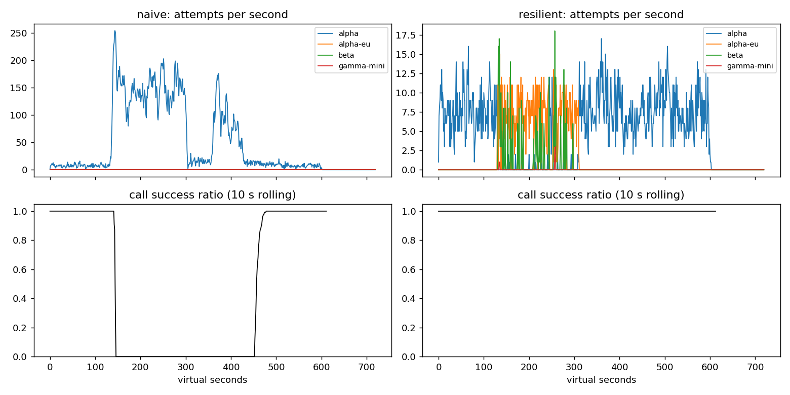

# Lab 25B — Report

**Họ tên / nhóm:** Bùi Đức Vinh — MSV 2A202602801  **Commit:** `215ddf06accf7247c5f0a6a408f89cd2d97b0cbf`  **Điểm tự động (`make grade`):** 84 / 88
(4 điểm còn lại là phần SLO trên dữ liệu ẩn do giảng viên chấm; `slo_hidden` hiện là `None`.)

> Mọi số bên dưới lấy từ `reports/gameday/*.json`, `reports/workflows.json`, `reports/slo.json`, `reports/cache/*.json`
> (seed 25, trừ khi ghi khác). Độ bền: 6 băng × **20 seed (20–39)** đều PASS, kể cả với một bộ băng "khó hơn" tự dựng
> (lệch thời điểm, tăng cường độ: alpha 9 rps, capacity 15%, lỗi 45%, +3,5 s / +8 s, outage 360 s, beta 7 rps).

## 1. Kết quả Game Day (naive vs của bạn)

| Băng | Client | availability | p95 (s) | amplification | retry_ratio | cost/turn | recovery (s) | PASS? |
|---|---|---:|---:|---:|---:|---:|---:|:---:|
| G1 | naive | 0,7194 | 7,157 | 7,738 | 6,738 | 2,163 | 4 | ✗ (avail, 36 027 vi phạm retry-after, ampl) |
| G1 | yours | **1,0** | 4,791 | 1,059 | 0,002 | 2,095 | 0 | ✓ |
| G2 | naive | 0,456 | 15,034 | 9,904 | 8,904 | 4,627 | 155 | ✗ (avail, ampl, recovery) |
| G2 | yours | **1,0** | 5,735 | 1,036 | 0,007 | 2,111 | 0 | ✓ (primary share 1,0) |
| G3 | naive | 1,0 | 4,768 | 1,164 | 0,164 | 2,328 | 0 | ✗ (retry_ratio) |
| G3 | yours | 1,0 | 4,718 | 1,065 | 0,035 | 2,146 | 0 | ✓ |
| G4 | naive | 1,0 | 13,764 | 1,004 | 0,004 | 2,008 | 0 | ✗ (p95) |
| G4 | yours | 1,0 | **5,655** | 1,028 | 0,004 | 2,106 | 0 | ✓ (primary share 1,0) |
| G5 | naive | 0,3699 | 5,359 | 17,03 | 16,03 | 2,124 | – | ✗ (retry lỗi 400, avail) |
| G5 | yours | 0,8179 | 5,481 | 1,003 | 0,003 | 2,504 | – | ✓ (0 retry 400, 0 failover thừa) |
| G6 | naive | 0,517 | 4,836 | 12,344 | 11,344 | 2,009 | 0 | ✗ (avail) |
| G6 | yours | **1,0** | 6,14 | 1,06 | 0,025 | 2,192 | 0 | ✓ (0 incompatible route) |

Toàn bộ băng của client mới: `retry_after_violations = 0`, `client_error_retries = 0`, `incompatible_routes = 0`,
`unneeded_failovers = 0`. Ở G5, 413 lượt GiveUp đều là `client_error` (request malformed — không client nào cứu được).

## 2. Cấu hình client và lý do

| Tham số | Giá trị | Vì sao (dựa trên băng nào, số liệu nào) |
|---|---:|---|
| attempt_timeout_s | **6,0** (starter 8) | p99 lúc bình thường: alpha 2,7 s, alpha-eu 3,4 s, beta 4,1 s (log-normal σ = 0,35) → 6 s vẫn trên p99,9 của beta. Timeout ngắn hơn giảm thời gian "chết" khi provider treo: G2 p95 **10,78 s → 5,74 s** khi đổi 8 → 6. Với deadline 30 s cho 2 call, 6 s chừa đủ chỗ cho ≥ 1 lần failover mỗi call. Thí nghiệm 2 cho thấy 30 s làm G6 tụt còn 0,949. |
| max_attempts_per_provider | 2 | Tối đa 1 retry cùng provider (có jitter + budget) rồi fail over. G3 retry_ratio = 0,035 (≤ 0,10). Lên 5 thì G2 amplification 1,40 và p95 15,6 s ngay cả khi có budget (thí nghiệm 1). |
| backoff_base_s / cap_s | 0,25 / 4,0 | Full jitter: retry đầu trong U(0; 0,25 s) — đủ nhanh cho lỗi 500 lẻ tẻ (G3), cap 4 s để retry không bao giờ ăn quá 1/7 deadline. Rate limit thì dùng `retry_after + U(0; 0,25)` → 0 vi phạm ở G1. |
| retry_budget_ratio | 0,1 (+0,5 token/s, tối đa 20) | Retry ≤ ~10% lưu lượng gốc. Ở G3, ~8 call/s × 0,1 + 0,5/s ≈ 1,3 retry/s → retry_ratio 0,035; khi breaker hỏng, tắt budget làm G3 retry_ratio 0,068 → **0,158** (FAIL) và G2 ampl 1,40 → 1,665. |
| breaker.window_size / min_calls | 20 / 10 | ~8 call/s → cửa sổ 20 kết quả ≈ 2,5 s lịch sử của alpha: phản ứng nhanh (G2 ampl 1,036, recovery 0 s) nhưng không trip vì 1–2 lỗi lẻ (lỗi nền 0,2%). |
| breaker.failure_rate_threshold | 0,5 | G3 (30% lỗi 500) **không** trip breaker — đúng: 70% request vẫn thành công, chỉ cần 1 retry/failover; G2/G6 (≈ 100% lỗi/timeout) trip sau 10 kết quả. Với băng tự dựng 45% lỗi vẫn PASS (retry_ratio 0,02). |
| breaker.slow_call_s | **4,0** (starter 5) | Ngưỡng ≈ p99 bình thường của provider chậm nhất (beta 4,06 s; chỉ 1,1% call của beta chậm hơn 4 s, xa ngưỡng 60%). Một lượt có 2 call nên mỗi call phải ≤ ~5 s để p95 ≤ 10 s. Với băng tự dựng "+3,5 s" (call ~4,7 s < 5 s), slow_call 5 s **không** trip và p95 = **10,85 s** (FAIL 20/20 seed); hạ xuống 4 s → p95 5,70 s. |
| breaker.slow_rate_threshold | 0,6 | Giữ nguyên: G4 có ~100% call chậm → trip ngay; lúc bình thường < 2% chậm. |
| breaker.open_duration_s | 10 | Sau khi sự cố hết, alpha được probe lại trong ≤ 10 s → G2/G4/G6 `primary_share_after_restore` = 1,0 và recovery 0 s; ngắn hơn chỉ tốn thêm probe vào provider còn hỏng. |
| breaker.half_open_max_probes | 2 (cần 2 success) | Chỉ 2 request "thử nước" khi alpha đang hồi phục — không có thundering herd; 2 success liên tiếp là đủ tin cậy để đóng (G2 primary share 1,0). |
| quota_cooldown_s | 300 | Hết quota không tự hết sau vài giây: G5 sau khi A-large hết quota mọi call đi thẳng beta, ampl 1,003. |

Sơ đồ quyết định của `on_error`:

```
lỗi ──► classify(err)
  │
  ├─ CLIENT_ERROR (400/401/422)   breaker.release   → GiveUp("client_error")   (không retry, không failover)
  ├─ QUOTA_EXHAUSTED (429 quota)  breaker.release   → cooldown[p] = now+300 s  → failover ngay (delay 0)
  ├─ RATE_LIMITED (429 + RA)      breaker.release   → cooldown[p] = now+retry_after → failover ngay
  │                                                   (hết thang? chờ cooldown ngắn ≤ 5 s + jitter nếu kịp deadline)
  └─ OVERLOADED / SERVER_ERROR / TIMEOUT   breaker.on_failure
        tries < 2  AND breaker CLOSED  AND now+backoff+1 s ≤ deadline  AND budget.try_acquire()
             ├─ có → retry CÙNG provider sau backoff full-jitter
             └─ không → failover sang rung kế tiếp
_route(): bỏ qua provider đang cooldown hoặc breaker từ chối; timeout = min(6 s, deadline − now);
          ladder("tool") = [alpha, alpha-eu, beta] (gamma-mini không có tool calling)
```

## 3. Ba thí nghiệm

1. **Retry budget là lớp phòng thủ cuối** (breaker `min_calls: 1e9` ⇒ không bao giờ trip, `max_attempts_per_provider: 5`):

   | Băng | Cấu hình | availability | amplification | retry_ratio | recovery (s) | p95 (s) |
   |---|---|---:|---:|---:|---:|---:|
   | G2 | mặc định (breaker đúng) | 1,0 | 1,036 | 0,007 | 0 | 5,7 |
   | G2 | (a) breaker hỏng, **có** budget | 1,0 | 1,40 | 0,06 | 0 | 15,6 |
   | G2 | (b) breaker hỏng, **không** budget | 0,977 (54 GiveUp deadline) | **1,665** ✗ | **0,437** | **38** ✗ | 19,1 |
   | G3 | mặc định | 1,0 | 1,065 | 0,035 | 0 | 4,7 |
   | G3 | (a) có budget | 1,0 | 1,136 | 0,068 | 0 | 4,6 |
   | G3 | (b) không budget | 1,0 | 1,162 | **0,158** ✗ | 0 | 4,7 |

   Khi breaker không làm việc, budget là thứ duy nhất chặn retry storm: nó giữ retry ở ~10% lưu lượng nên G2 không
   rơi vào vòng metastable (recovery 0 s thay vì 38 s). Khi breaker hoạt động đúng thì budget gần như không bao giờ
   chạm trần (G2 retry_ratio chỉ 0,007) — breaker cắt tải *trước* khi budget cần làm việc. Nhưng breaker phụ thuộc cấu
   hình (min_calls, ngưỡng) và chỉ thấy một provider; budget là giới hạn **toàn cục, không phụ thuộc chẩn đoán**: một
   breaker cấu hình sai, một lỗi mới chưa được phân loại, hay lỗi rải rác trên nhiều provider vẫn bị chặn. Hai lớp bổ
   sung nhau: breaker = "đừng gửi vào chỗ đang hỏng", budget = "dù gì đi nữa, tổng retry không vượt 10%".

2. **`attempt_timeout_s: 30`.**

   | Băng | timeout | availability | give_up_reasons | p95 (s) | attempts alpha-eu |
   |---|---:|---:|---|---:|---:|
   | G6 | 6 | **1,0** | {} | 6,14 | 80 |
   | G6 | 30 | **0,949** ✗ | deadline 109, no_provider 13 | 5,40 | 122 |
   | G4 | 6 | 1,0 | {} | 5,66 | 2017 |
   | G4 | 30 | 1,0 | {} | 5,61 | 1956 |

   Ở G6, alpha-eu *treo* (không trả lỗi): mỗi call rơi vào alpha-eu (trước khi breaker mở, và các probe HALF-OPEN mỗi
   10 s) phải đợi trọn 30 s = toàn bộ deadline của user → 109 lượt chết vì `deadline`. p95 lại *giảm* (6,14 → 5,40)
   vì chỉ tính lượt thành công — những lượt lẽ ra chậm đã biến thành thất bại (survivorship bias). G4 gần như không
   đổi vì alpha vẫn trả lời trong ~6,2 s và **breaker slow-call** (không phải timeout) là cơ chế đẩy traffic sang
   alpha-eu; timeout không bao giờ nổ. Timeout đúng phải nằm trên p99 lúc bình thường (để không cắt request khỏe —
   beta p99 ≈ 4,1 s) nhưng đủ nhỏ để `timeout + 1 lần failover + call thứ hai` vẫn vừa deadline 30 s của user; 6 s
   thỏa cả hai. Deadline của user là trần, không phải giá trị timeout.

3. **Bỏ lọc tool calling khỏi `ladder()`** (G6): `incompatible_routes` 0 → **251**, availability 1,0 → **0,895**,
   cost/turn 2,192 → 2,294. Nói theo ngôn ngữ PM: trong lúc provider A sập, khoảng **1 trên 10 khách hàng** yêu cầu hoàn
   tiền được chuyển cho một model "rẻ" không biết thao tác hệ thống; nó trả lời nghe có vẻ hợp lý nhưng **không thực hiện
   hoàn tiền** — khách nghĩ đã xong nhưng thực ra không, ta vẫn trả tiền cho call đó và sau đó phải xử lý khiếu nại.
   Một câu trả lời sai tự tin còn tệ hơn một thông báo "hệ thống đang bận, thử lại sau".

## 4. Workflow hoàn tiền

| Executor | completion | crashes | duplicate refunds | duplicate emails | lost refunds | overpaid | wasted LLM / crash |
|---|---:|---:|---:|---:|---:|---:|---:|
| naive | 1,0 | 81 | **128** | **81** | 0 | **14 967,00** (1 496 700 cents) | 1,123 |
| yours | 1,0 | 66 | 0 | 0 | 0 | 0 | 0,303 |

- **Chỉ idempotency key là chưa đủ:** key chống trùng ở phía payment/email, nhưng worker mới không biết bước nào đã
  xong nên phải chạy lại *mọi* bước từ đầu → tốn lại LLM `classify`/`summarize` (naive 1,123 call thừa/crash vs 0,303)
  và vẫn phụ thuộc hoàn toàn vào việc API bên ngoài giữ key bao lâu (Stripe chỉ giữ 24 h).
- **Chỉ checkpoint là chưa đủ:** worker có thể chết *sau* khi tiền đã đi nhưng *trước* khi kịp ghi checkpoint
  (`crash_after_commit`), hoặc response bị mất (`ServiceTimeout`). Worker mới không thấy checkpoint → gọi refund lại →
  không có key ổn định thì thành hoàn tiền trùng.
- **Ghi checkpoint *trước* khi gọi payment:** nếu worker chết giữa lúc ghi checkpoint và lúc payment chạy (hoặc payment
  trả `ServiceError`), worker mới thấy checkpoint "đã xong" và bỏ qua bước → **hoàn tiền bị mất** (khách không nhận
  tiền mà hệ thống ghi là đã hoàn). Thứ tự đúng: execute (với key ổn định `refund-agent:{session}:{step}`) → ghi
  checkpoint → bước sau. Hai cơ chế cùng nhau cho *exactly-once effect*.

## 5. Alerting & error budget

| Sự cố | Mong đợi | Naive alerter (5 phút > 5%) | Burn-rate alerter | Độ trễ phát hiện (burn-rate) |
|---|---|---|---|---:|
| checkout_bug | page | page (1 phút) | page ✓ | 27 phút (hạn 35) |
| provider_outage | page | page (0 phút) | page ✓ | 4 phút (hạn 8) |
| deploy_blip | none | **page sai** | không page ✓ | – |
| slow_leak | ticket | **bỏ sót** | ticket ✓ (không page) | 1 337 phút ≈ 22 h (hạn 30 h) |
| degraded_evening | page | page (214 phút) | page ✓ (luật 6× / 6h) | 291 phút (hạn 330) |
| night_spike | none | **page sai** | không page ✓ | – |
| small_bump | none | **page sai** | không page ✓ | – |

Naive: 7 page, 3 false page, bỏ sót slow_leak → FAIL. Burn-rate: 3 page, 1 ticket, **0 false page** → PASS
(và PASS trên 10 bộ dữ liệu tự sinh với seed khác + sự cố dời ±10 h).

Error budget 30 ngày (`error_budget_report`): 25 901 755 request, cho phép 129 508,8 lỗi, thực tế 55 618 lỗi
(availability 99,7853%) → **đã tiêu 42,95%, còn 57,05%** → **không** đóng băng release.

`small_bump` (20 phút × 12% lỗi): burn rate 24× nhưng chỉ trong 20 phút — cửa sổ 1 giờ chỉ đạt ≈ 24 × 20/60 = 8× < 14,4×,
nên không page. Nó tiêu ≈ 20 × 0,12 / (0,005 × 43 200) ≈ **1,1% budget tháng** và tự hết. Page nghĩa là "cần người
hành động *ngay*"; một sự cố tự hồi phục, tốn 1% budget thì đánh thức/gián đoạn on-call chỉ gây alert fatigue — đúng
chỗ của nó là dashboard/ticket để xem lại.

## 6. Postmortem — Băng G2 với client naive (blameless)

*Nguồn: `reports/gameday/G2_overload_storm.png`, `reports/gameday/naive_G2_overload_storm_timeseries.csv`
(số dưới đây là trung bình mỗi giây trên cửa sổ 10 s), `reports/gameday/naive.json`.*



**Tóm tắt:** Lúc t = 120 s, deployment `alpha` mất 75% GPU trong 3 phút. Lớp retry của ShopAgent v1 (3 tầng chồng nhau,
tối đa 36 attempt/call, delay cố định 0,2 s, không breaker, không fallback) khuếch đại tải lên alpha từ ~9 lên tới
~210 attempt/s, giữ alpha bão hòa ngay cả sau khi GPU đã quay lại ở t = 300 s. Dịch vụ sập hoàn toàn từ t ≈ 140 s đến
t ≈ 455 s (~5 phút 15 giây) — gấp gần 2 lần thời gian của sự cố gốc.

**Ảnh hưởng:** 1 285 / 2 362 lượt user thất bại (availability 45,6%); thành công = 0 trong ~310 s liên tục; p95 của
lượt thành công 15,0 s; 34 475 attempt cho 3 481 call (amplification 9,9) trong đó 26 298 lỗi 429, 3 194 lỗi 529,
2 737 timeout; chi phí/lượt tốt 4,63 (gấp 2,2 lần bình thường ~2,1). Giả sử tháng chỉ có sự cố này, lưu lượng
4 lượt/s × 30 ngày = 10,37 triệu lượt, budget 0,5% = 51 840 lượt lỗi → sự cố tiêu **≈ 2,5% error budget tháng** trong 5 phút
(trong lúc sập, 100% lỗi ⇒ burn rate = 1 / 0,005 = 200× — vượt xa ngưỡng page 14,4×).

**Timeline** (giây ảo):

| t | Sự kiện | Bằng chứng (số) |
|---:|---|---|
| 0–120 | Bình thường | alpha 8,7–9,1 attempt/s, success 1,00 |
| 120 | alpha mất 75% năng lực (trigger) | service time ×4; call hoàn tất giảm 9,2 → 3,2/s, success vẫn 1,00 nhưng chậm |
| 130–140 | Hàng đợi dài ra, timeout 8 s bắt đầu nổ, 3 tầng retry kích hoạt | alpha 51,9 attempt/s (×6) |
| 140–150 | Retry storm: tải vượt rate limit 20 rps → 429, mỗi 429 lại sinh retry sau 0,2 s | **214 attempt/s** (×24), success **0,00** |
| 150–300 | Trạng thái sập ổn định | 110–169 attempt/s, success 0,00; GiveUp `retries_exhausted` 655 + `deadline` 585 |
| 300 | alpha hồi phục hoàn toàn | — nhưng success vẫn 0,00 |
| 300–360 | Hàng đợi vẫn đầy request mà client đã bỏ (server vẫn xử lý), timeout tiếp tục | 15–18 attempt/s, success 0,00 |
| 360–420 | Đợt retry thứ hai khi các call mới đồng loạt nhận lỗi rồi retry cố định 0,2 s | 71–130 attempt/s, success 0,00 |
| 430–450 | Retry cạn dần, hàng đợi rút | 12–13 attempt/s, success 0,00 |
| 450–460 | Bắt đầu hồi phục | success 0,64 |
| ~455 | Đạt 95% success trong 30 s (`recovery_s` = 155 s sau khi alpha hồi phục) | 460–470: success 0,93; 470+: 1,00 |

**Trigger vs root cause:** *Trigger* là sự cố hạ tầng: alpha mất 75% GPU trong 3 phút. *Root cause* là thiết kế lớp
retry: 3 tầng retry độc lập chồng nhau (app × gateway × SDK = 36 attempt/call), delay cố định không jitter, không retry
budget, không phân biệt loại lỗi (retry cả 429, không tôn trọng `retry-after`), không circuit breaker và không fallback.
Thiết kế này biến giảm năng lực thành **khuếch đại tải** (×24) — một provider đang chậm nhận lượng request gấp hàng chục
lần năng lực của nó.

**Vì sao provider đã hồi phục mà hệ thống vẫn sập (metastable failure):** vòng lặp tự duy trì là
*timeout → retry → hàng đợi dài hơn → nhiều timeout hơn → nhiều retry hơn*. (1) Server không hủy request khi client
timeout, nên sau t = 300 alpha vẫn phải xử lý hết hàng đợi request mà không ai còn chờ — năng lực "khỏe" bị dùng cho
công việc vô ích. (2) Lượng retry (15–130 attempt/s) vẫn lớn hơn năng lực thực (~15 rps với 18 slot × 1,2 s) và rate
limit 20 rps, nên request mới luôn xếp sau request "ma" và cũng timeout. Hệ thống chỉ thoát ra khi các call cạn retry
/ hết deadline 30 s và lưu lượng retry tự giảm xuống dưới năng lực — ~155 s sau khi trigger đã biến mất.

**Điều gì giúp / điều gì làm tệ hơn:**
- *Giúp:* deadline 30 s của lượt user cuối cùng cũng giới hạn số retry mỗi call; rate limit 20 rps phía provider
  chặn bớt tải vào hàng đợi (dù đổi lại bằng 26 298 lỗi 429).
- *Tệ hơn:* delay cố định 0,2 s đồng bộ hóa các client (retry đến thành từng đợt, thấy rõ đỉnh thứ hai ở t = 360–420);
  retry cả lỗi 429 mà không nhìn `retry-after`; không có breaker nên không có lúc nào alpha được "nghỉ" để rút hàng
  đợi; không có fallback dù alpha-eu và beta đang rảnh hoàn toàn (0 attempt).

**Action items:**

| # | Hành động | Loại | Owner | Cách kiểm chứng |
|---|---|---|---|---|
| 1 | Gỡ retry ở gateway + SDK, chỉ giữ **1 tầng** retry trong `ResilientClient` (full jitter, tôn trọng `retry-after`, retry budget 10%) | prevent | Platform team (LLM gateway) | CI chạy `make gameday`: G2 `amplification ≤ 1,2`, `retry_after_violations = 0` trên 3 seed (hiện 1,036 / 0) |
| 2 | Circuit breaker sliding-window (tỷ lệ lỗi + slow call) cho từng deployment, fallback ladder alpha → alpha-eu → beta có lọc tool calling | mitigate | Agent runtime team | G2 `recovery_s ≤ 30`, `availability ≥ 0,95`; G6 `incompatible_routes = 0` trong CI (hiện 0 s / 1,0 / 0) |
| 3 | Alert burn-rate đa cửa sổ (14,4× 1h&5m, 6× 6h&30m) trên SLI lượt user + alert riêng khi `amplification` > 1,5 trong 5 phút | detect | SRE on-call rotation | Replay `data/sli_30d.csv`: page mọi sự cố lớn, 0 false page (`make slo` PASS); bài game day kế tiếp phải page trong ≤ 5 phút |
| 4 | Game day hằng quý với 6 băng sự cố (+ băng ẩn, nhiều seed) như một bước bắt buộc trước khi đổi cấu hình retry/timeout | prevent | Engineering manager ShopAgent | Lịch game day trong runbook; `make grade` ≥ 84/88 là điều kiện merge thay đổi `configs/gameday.yaml` |

## 7. Một điểm yếu còn lại

**Cả 4 provider cùng chậm (ví dụ một sự cố mạng chung ở region us).** Khi mọi deployment trả lời trong ~5–6 s, breaker
slow-call (ngưỡng 4 s) của *tất cả* đều mở; `_route` đi hết thang mà không có provider nào được phép → `GiveUp
("no_provider_available")`, dù thực ra một câu trả lời 6 s vẫn nằm gọn trong deadline 30 s. Breaker "slow" lúc đó đổi một
lượt chậm thành một lượt **thất bại**. Cách sửa: tách "slow" khỏi "failed" khi chọn đường — nếu mọi rung đều OPEN chỉ vì
`slow_call_rate` (không phải `failure_rate`), cho phép gửi tới provider có độ trễ gần nhất thấp nhất (least-bad routing)
với timeout = thời gian còn lại; đồng thời theo dõi độ trễ theo phân vị động (EWMA p95) thay vì ngưỡng cố định 4 s, để
khi "chậm" là trạng thái chung thì không coi đó là lỗi của riêng provider nào. Một điểm yếu phụ: chi phí khi beta gánh
tải (G5 cost/turn 2,50 so với ~2,1) — có thể đưa `gamma-mini` lên trước beta cho call `chat` khi A-large hết quota.

## 8. Cache (Part G)

Số từ `reports/cache/*.json` (`make cache`, seed 25).

| Client | availability | faq_availability | cache_hit_ratio | stale_served | wrong_answers | outdated_answers | cost/turn | PASS? |
|---|---:|---:|---:|---:|---:|---:|---:|:---:|
| resilient (không cache) | 0,8373 | 0,8424 | 0,0 | 0 | 0 | 0 | 1,386 | ✗ |
| cached — cấu hình starter (0,80 / 600 / 0) | 0,8469 | 0,8587 | 0,742 | 0 | **181** (other_question) | **80** | 0,921 | ✗ |
| **cached (của tôi)** | **0,9117** | **0,9645** | **0,568** | 189 | **0** | 2 | **0,971** | ✓ |

Cache giảm chi phí/lượt 30% (1,386 → 0,971) và giữ FAQ sống qua 2 phút mọi provider sập (faq_availability 0,84 → 0,96).
Kiểm tra trên 20 seed (20–39): 0 lần FAIL, `outdated_answers` tối đa 8, `cache_hit_ratio` tối thiểu 0,547.

| Tham số `cache:` | Giá trị | Vì sao (số liệu nào) |
|---|---:|---|
| similarity_threshold | **0,90** | Paraphrase cùng ý có cosine ~0,95–0,98; cặp "gần mà khác" (hoàn tiền chính sách vs thời gian, đổi size vs màu, ship nội thành vs tỉnh) ~0,82–0,85. 0,80 → 100–181 `other_question`; 0,90 → 0 sai, vẫn gom được mọi paraphrase (hit 0,568); 0,97 → hit chỉ 0,47 (FAIL, cost 1,038) vì paraphrase bị coi là câu mới. 0,90 nằm giữa hai cụm với biên ~0,05 mỗi phía. |
| ttl_s | **25** | Thay đổi không báo trước (bảng phí ship lúc t = 480) chỉ bị TTL giới hạn: số câu `outdated` ≈ tốc độ hit của intent đó × TTL. 20 seed: TTL 25 → outdated TB 2,3 / max 8, hit min 0,547; TTL 30 → max 13; TTL 45 → max 22 (3/20 FAIL); TTL 90 → max 25 (5/20 FAIL); TTL 300 → 95. (TTL 60 tình cờ tốt trên băng public — max 10 — chỉ vì entry tạo lại sau deploy v2 lúc 420 hết hạn đúng lúc 480; không tin được trên băng ẩn đã dời thời điểm.) 25 s giữ cả hai ràng buộc với biên an toàn. |
| max_stale_s | **300** | Sự cố mọi provider sập kéo dài 120 s; entry phải còn trong cửa sổ stale suốt sự cố: cần `max_stale_s ≥ 120` + biên cho băng ẩn dài hơn. 0 → faq_availability 0,855 (FAIL); 60 → 0,920 (FAIL: các entry hết hạn giữa sự cố); 300 → 0,9645, 189 câu stale được phục vụ. |
| max_entries | 500 | Catalog chỉ có 18 intent chia sẻ × vài prompt version → không bao giờ chạm trần; LRU chỉ là lưới an toàn bộ nhớ. |

Thí nghiệm:

1. **Ngưỡng.** 0,80: hit 0,58, `wrong_answers` = 100 (`other_question`), cost 1,004 → FAIL. 0,90: hit 0,568, 0 sai, cost
   0,971. 0,97: hit 0,47, 0 sai, cost 1,038 → FAIL hit ratio. Câu bị trả nhầm ở 0,80 là các cặp intent cố ý đặt gần
   nhau (centroid cosine 0,86). Đếm theo cặp (hỏi → nhận câu trả lời của), seed 25 với ngưỡng 0,80 (+ TTL/stale của
   tôi): phí ship tỉnh → nội thành **35**, nội thành → tỉnh **31**, COD → hình thức thanh toán **16**, thời gian hoàn tiền
   → chính sách hoàn tiền **7**, thanh toán → COD 4, đổi màu → đổi size 3, chính sách → thời gian hoàn tiền 2, đổi size →
   đổi màu 2. Đúng loại lỗi nguy hiểm: khách ở tỉnh được báo phí ship nội thành.
2. **TTL.** 25 / 30 / 60 / 300 → outdated 2 / 2 / 3 / **95**, hit 0,568 / 0,592 / 0,652 / 0,731 (seed 25). Webhook chỉ
   giúp khi nguồn *báo* thay đổi (chính sách hoàn tiền t = 150 → `invalidate("policy/refund")`, 0
   `ignored_invalidation`). Bảng phí ship đổi **không có webhook**: cache không có tín hiệu nào để biết câu trả lời cũ
   đã sai, nên cận trên duy nhất của thời gian phục vụ câu trả lời lỗi thời là tuổi tối đa của entry = TTL.
3. **Stale-if-error.** `max_stale_s: 0` → faq_availability 0,9645 → **0,8547**, hit 0,568 → 0,458, stale_served 189 → 0
   (gần bằng client không cache, 0,8424): trong 2 phút sập, câu FAQ chung không có gì để trả lời.

Trả lời:

- **Vì sao không cache câu hỏi cá nhân, kể cả theo từng user?** (1) Câu trả lời phụ thuộc dữ liệu thay đổi từng phút
  (đơn đang giao, tiền hoàn đã về chưa) — cache trả lời "đang giao" khi đơn đã giao xong là sai sự thật về *tiền và hàng
  của khách*. (2) Embedding của "Đơn #48213…" và "Đơn #48214…" giống nhau ~0,99: cache theo ngữ nghĩa sẽ coi chúng là
  một câu → lộ đơn hàng của người khác (`other_user`); muốn an toàn thì key phải gồm user_id + order_id, lúc đó hầu như
  không bao giờ có hit (mỗi user hỏi rất ít lần) — rủi ro quyền riêng tư lớn, lợi ích gần 0. (3) Trong lúc sự cố, trả
  lời cũ về dữ liệu cá nhân còn nguy hiểm hơn nói thật "hệ thống đang gián đoạn".
- **Dashboard xanh nhờ cache — alert dựa trên gì?** Không alert trên availability phía user (đang bị cache che). Alert
  trên SLI **phía provider/không cache**: tỷ lệ attempt thành công tới provider và tỷ lệ `GiveUp` của inner client
  (burn-rate như Part E), cộng với **tỷ lệ câu trả lời stale** (`stale_served / FAQ turns`, ví dụ page khi > 5% trong 5
  phút) và tỷ lệ lượt không phải FAQ thất bại (availability tổng 0,91 trong khi faq_availability 0,96). Stale > 0 nghĩa
  là "đang chạy bằng phương án dự phòng" — on-call phải biết, kể cả khi user chưa thấy lỗi.
